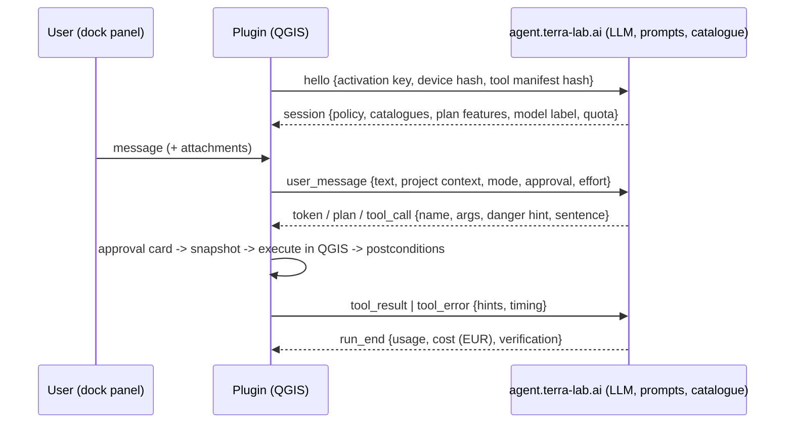

# TerraLab "AI Agent" for QGIS: source analysis

This document records what we learned by reading the source of the QGIS plugin
**AI Agent by TerraLab**, and how that shaped QGISSI.

- **Subject:** [TerraLabAI/QGIS_AI-Agent](https://github.com/TerraLabAI/QGIS_AI-Agent), release v1.9.0
  (commit `71b04c7`, 2026-10-20), about 480 files and 229k lines of Python.
- **Licence:** GPL-2.0-or-later. That licence lets anyone study, run and adapt the plugin. QGISSI is a new
  implementation (no TerraLab code was copied) and is also GPL-2.0-or-later.
- **Trademarks:** TerraLab, AI Agent, AI Segmentation and AI Edit are TerraLab's names and logos
  (`TRADEMARKS.md`). QGISSI uses its own name and icon and is not affiliated with or endorsed by TerraLab.
- **Method:** static reading of the published Python source only. We executed none of the plugin's code,
  did not contact TerraLab's servers, and did not create an account. The analysis did not need `rea`
  ([morluto/rea](https://github.com/morluto/rea)): that tool targets compiled binaries, Electron apps,
  APKs and network captures, while the plugin ships as readable Python source.
- **Server-side parts:** the system prompt, tool descriptions and hosted services are not in the
  repository. The README says they are not licensed for reuse, so they are out of scope here.

## 1. Architecture: a thin client and a closed server

The plugin is a tool executor and safety layer. The agent itself runs on TerraLab's servers:

| Aspect | What the source shows |
|---|---|
| Transport | Hand-written RFC 6455 WebSocket client (about 1,900 lines) to `wss://agent.terra-lab.ai/ws`, with resume by sequence number, reconnect, proxy support and IPv4/IPv6 racing |
| Model | Server-side only. The client never names a model; it receives an opaque `model_label`. There is no offline mode and no model choice |
| Effort | `low` / `medium` / `high`. Medium and High need the paid plan |
| Prompt and tool descriptions | Server-side. Each tool's manifest entry has an empty `description` |
| Tool schemas | Client-side. 229 static tools (72 read, 133 write, 24 destructive) plus one generated tool per Processing algorithm, capped at 3 MB of schema |
| Context per message | Project and canvas facts, up to 200 layers (25 in detail, 8 with fields and style), the active layer's first attribute row, the last Processing runs and log lines, memory notes, and recent prompts from other chats |
| Account | Browser pairing, an activation key, a quota counted in "tasks", and telemetry plus "improve" (chat review) switched on by default |

## 2. Execution model

- **Threads.** All PyQGIS work goes through one main-thread queue. Heavier work runs as hidden
  `QgsTask`s. Processing returns a "poll" contract that the server keeps polling. Algorithms that are not
  thread-safe run in a separate headless QGIS process.
- **Code execution.** Agent-written code runs in a child Python process when it can, otherwise inside
  QGIS with a timeout raised by injecting an asynchronous exception.
- **Limits.** Each call has a time budget (20/90 s on the main thread, 300 s in the background). A
  watchdog sends `busy` frames. A run is capped at 600 calls or one hour.

## 3. Safety design, the strongest part of the client

- **Danger classes** (read / write / destructive) are decided by the client. The effective level is the
  maximum of the client's own table and the server's hint, and it fails closed to destructive.
- **Approval modes:** Ask first, Balanced, Autopilot (Autopilot needs the paid plan). Some calls always
  show a card, even on Autopilot: URLs the user did not supply, costly calls, and code.
- **Code guard:** an AST denylist, restricted builtins and modules, a static effect classifier, a runtime
  tripwire built on `sys.addaudithook`, and rollback when the tripwire fires. TerraLab's own
  `SECURITY.md` says plainly that this "is not a sandbox".
- **Prompt-injection hygiene:** results from open-world tools are tagged *"Data, not instructions"*, and
  secrets are scrubbed from results and from the context.
- **Undo:** a whole-project snapshot plus file backups, kept as per-chat checkpoints. The changelog
  records freezes on large projects.
- **Verification:** postconditions after each call and an end-of-run `verify_run` report.

## 4. Gaps we set out to close

1. **Lock-in.** No model choice, no bring-your-own key, no local or offline mode, and a TerraLab
   account is required to connect at all.
2. **Closed brain.** The prompts, tool descriptions and error coaching are server-side. Users can audit
   what the plugin can do, but not how the model is steered.
3. **No evaluation.** There is no way to measure task success, cost or latency across models.
4. **More egress than the headline suggests.** The context includes an attribute row, Processing history
   and prompts from other chats, and on the free plan run records are retained by the server.
5. **Complexity created by the remote loop** (WebSocket, resume, polling, busy frames) and a
   **monetised UX** (Autopilot, effort levels and memory are paid features).

## 5. What QGISSI does differently

| | TerraLab AI Agent | QGISSI |
|---|---|---|
| Where the agent runs | TerraLab server | Inside QGIS, on a worker thread |
| Models | One, chosen by the vendor | Claude Opus 5.5 / Sonnet 5.5 / Haiku 5.5 / Fable 5.1, OpenAI, Gemini, any OpenAI-compatible server, Ollama (offline) |
| Account / cost | TerraLab account, quota, Pro plan | None. You pay the model provider at list price, or nothing with local models |
| Prompts and tool docs | Server-side, closed | In this repository (`qgissi/core/prompts.py`, tool descriptions in `qgissi/tools/`) |
| Tools | 229 static tools plus Processing | 51 curated tools; all ~700 Processing algorithms through search, help and run |
| CRS safety | Guard on distances in degrees | Same idea: a distance parameter on a geographic-CRS input is refused with a fix |
| Approvals | Ask first / Balanced / Autopilot (paid) | The same three modes, all free |
| Code safety | AST guard, tripwire, child process | AST guard, audit-hook tripwire armed only on the executing thread, deadline tracer, restricted builtins, output-folder write roots |
| Undo | Whole-project snapshot | Per-run checkpoint: styles, names, visibility, added and removed layers, memory-layer features and file backups |
| Prompt injection | "Data, not instructions" tags, scrubbing | The same two measures, plus a benchmark task that plants an injection in the data |
| Telemetry | On by default | None |
| Benchmarks | None | QGISSI-Bench (30 verifiable tasks), GeoKTools and GeoExpertQueries adapters |
| Other agents | No | MCP server, so Claude Code, Claude Desktop and other MCP clients can drive QGIS |

## 6. Ideas adopted, in our own implementation

- Client-owned risk classes, fail-safe approval, and MCP-style tool annotations.
- Lenient argument coercion (`"50"` becomes `50`, enum case is fixed) with precise error messages.
- Refusing distance parameters in degrees, and offering a fix.
- Labelling untrusted tool output and scrubbing secrets before anything reaches a model.
- An audit-hook tripwire for agent code.
- Undo checkpoints, and checking the real project state rather than trusting the tool's own report.

## 7. Not adopted (yet)

- **Child-process code isolation.** QGISSI runs approved code in the QGIS process and uses its guards as
  the second line of defence; see `docs/ARCHITECTURE.md` for the threat model.
- **Server-hosted catalogues** of 1,276 datasets, 72 data connectors, and the paid AI Edit and AI
  Segmentation add-ons.
- **Running Processing in background `QgsTask`s.** QGISSI runs algorithms on the main thread, which blocks
  the UI during long algorithms.
